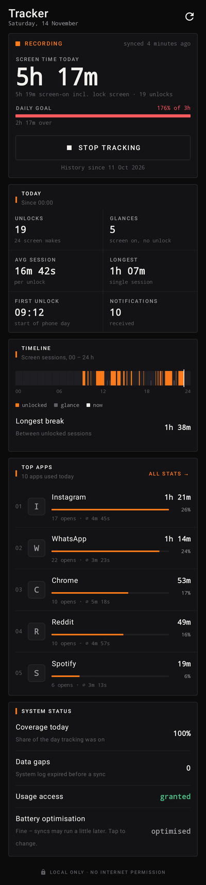
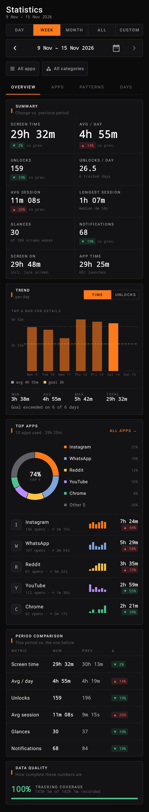
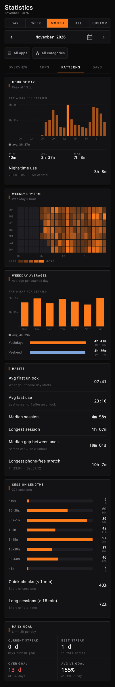
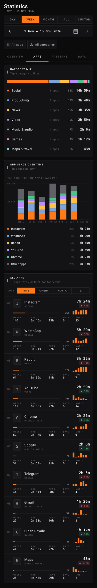
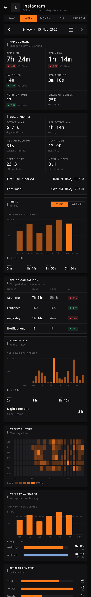
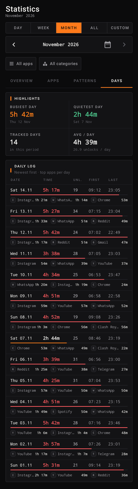

# Screentime Diagnostics

An Android app that records detailed screen time data that built-in tools summarise away: screen sessions, unlocks, glances, per-app sessions with timestamps, and (opt-in) notification counts. **All data stays on the device.** The app has no `INTERNET` permission.

## Features

- **Tracker tab**: status panel with today's screen time, goal progress and the start/stop action; today's metrics (unlocks, glances, sessions, first unlock, notifications), a 24-hour session timeline, top apps and system status.
- **Statistics tab**: day, week, month, all-time or custom range with ‹ › navigation; filter by apps and category. Four sections:
  - *Overview*: 10 KPIs with change vs. the previous period, trend chart (time or unlocks) with min/avg/max/total and goal line, top apps (donut of shares, per-app sparkline and change vs. the previous period), a period comparison table, and data-quality coverage
  - *Apps*: category mix, stacked "app usage over time" chart (tap a bar for the per-app split of that hour/day/week), and every app with its own mini-dashboard: time, change, share, trend sparkline, opens, average session, peak hour, active days and notifications; sortable by time, opens, notifications or change
  - *Patterns*: hour-of-day profile, weekday × hour heatmap, weekday averages (weekdays vs. weekend), habits (first/last use, night use, median gap, longest phone-free stretch), session lengths, and goal streaks
  - *Days*: busiest/quietest day highlights and a daily log (time, unlocks, first and last use, top three apps of each day)
- **App detail** (tap any app): the same analysis for one app over any day/week/month/all-time/custom range – summary with changes, usage profile (active days, per active day, median and longest session, peak hour, opens per day, notifications per open, first and last use), time/opens trend, period comparison, hour-of-day profile, weekday × hour heatmap, weekday averages, session lengths and a daily log.
- **Settings**:
  - sync interval and daily goal
  - retention and excluded apps (launcher, keyboard and system UI are excluded by default)
  - notification counter (opt-in) and biometric/PIN app lock
  - JSON backup export and import (merging), and CSV ZIP export for spreadsheets
  - delete all data
- **Home-screen widget**: today's time, unlocks and goal bar.
- **Backfill**: the first start imports whatever history Android still holds (usually 7–10 days).

## Screenshots

Rendered from sample data by the screenshot tests (`./gradlew :app:testDebugUnitTest`, output in `app/build/outputs/roborazzi/`).

| Tracker | Statistics: overview | Statistics: patterns |
| --- | --- | --- |
|  |  |  |

| Statistics: apps | App detail | Statistics: days |
| --- | --- | --- |
|  |  |  |

## How it works (battery)

Android already records the events needed in its usage log (`UsageStatsManager`): screen on/off, keyguard hidden (unlock), activity resumed/paused, shutdown/startup. The app does **not** run a background service. A periodic WorkManager job (default every 30 minutes, and whenever the app opens) reads only the new events and stores derived sessions in Room. Each run takes milliseconds.

Open sessions are stored provisionally. The next sync re-reads from their start and replaces them (natural primary keys), so re-syncs and imports are idempotent. If the app falls behind the system's retention window, the gap is recorded and shown under "Data quality".

## Project layout

| Module | Contents |
| --- | --- |
| `core/` | Pure Kotlin/JVM: `SessionBuilder` (events → sessions), `StatsCalculator`, `TimeRanges`, `BackupCodec`. Fully unit-tested. |
| `app/` | Android: Room DB, `TrackingManager` + `SyncWorker`, `NotificationCounterService`, widget, Compose UI. |

## Build

Requirements: JDK 17+ and the Android SDK (API 35).

```bash
./gradlew :core:test            # unit tests
./gradlew :app:assembleDebug    # app/build/outputs/apk/debug/app-debug.apk
```

The CI workflow (`.github/workflows/android.yml`) runs the tests, builds the debug and release APKs and uploads them as artifacts.

## Permissions

| Permission | Why | Required |
| --- | --- | --- |
| Usage access (`PACKAGE_USAGE_STATS`) | read the system usage log | yes, granted in system settings |
| Notification access | count notifications per app (package + time only) | optional |
| Biometric | app lock | optional |

Battery optimisation can stay on; syncs are then simply a little less punctual.

## Moving to a new phone

Settings → *Export full backup* → copy the `.json` file → on the new phone, Settings → *Import backup*. Imports merge and never overwrite existing rows.
